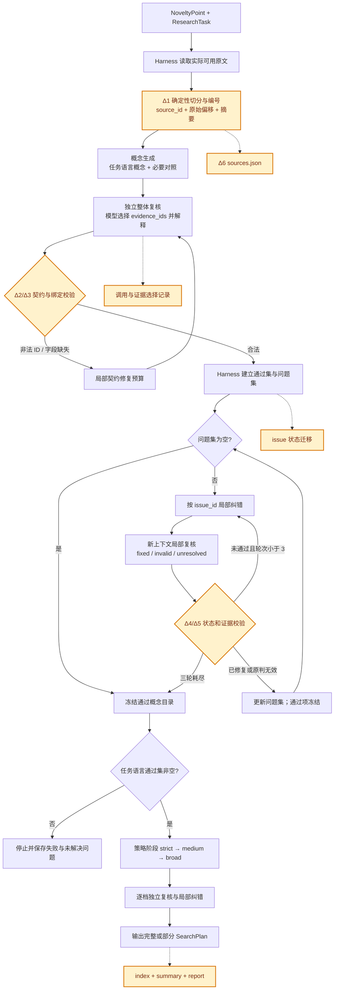

# Planner 两阶段重构：证据索引版 Codex 迭代计划（V2）

> 状态：待实施  
> 制定日期：2026-11-16  
> 当前开发基线：`1st-stage` / `7d4ebd37`  
> 原始实施基线：`main` / `7ff63dd0`  
> 适用范围：Planner 概念阶段的证据引用与纠错闭环，以及后续策略阶段接入  
> 重要说明：本文是开发计划，不代表其中的新机制已经实现或通过验收。

## 1. 目标与结论

本轮不再要求 Qwen 逐字抄写 `source_quote`。程序先把实际输入的查新点与技术特征切分为可追溯的原文片段，并发放稳定的 `source_id`；模型只负责选择证据编号并解释语义关系。Harness 负责验证编号、任务绑定、原文位置和字段覆盖，并根据编号恢复原文。

这个改动直接解决以下已确认问题：

1. 模型因漏字、标点、拼接片段或改写原句而反复触发输出契约修复。
2. 同一批候选的整体响应中，一个字段错误会导致整份审核反复重试。
3. 审计记录虽然保存了模型理由，但不能稳定定位理由引用的是哪一段实际输入。
4. 局部纠错容易把“格式修复”“审核撤销原判”和“候选确实被修正”混为一类。

它不能自动解决以下问题：

- 证据编号合法，不代表证据在语义上支持概念。
- Qwen 仍可能遗漏核心机制、错误判断别名，或持续给出相同误判。
- 正则切分只能建立原文边界和定位，不能替代模型审核及人工语义验收。
- `source_locations` 仅是位置描述，不是论文正文，不能作为正文证据发放。

因此，V2 的职责划分是：**程序保证来源真实、引用可定位、状态可推进；模型判断语义；人工完成最终语义签收。**

## 2. 与原方案的关系

### 2.1 保留不变的原方案要求

- Planner 仍分为概念阶段和策略阶段。
- 概念先生成，再使用独立上下文进行整体复核。
- 首次复核后建立通过集与错误集；遗漏作为独立问题。
- 错误集最多进行三轮局部纠错；首次生成和首次复核不计入三轮。
- 已通过且未修改的概念冻结，不重新送入局部纠错。
- 局部纠错后使用新上下文独立复核。
- 三轮结束后允许部分放行；任务语言通过集为空时停止。
- 运行级调用预算优先于剩余语义轮次。
- 策略阶段按 `strict → medium → broad` 推进，模型构造受限的 AND/OR 表达式。
- 模型替身只验证控制流程；真实模型与人工复核验证语义质量。

### 2.2 V2 新增或改写的部分

| 编号 | V2 变化 | 原方案中的对应内容 | 变化目的 |
| --- | --- | --- | --- |
| Δ1 | Harness 对真实输入做确定性切分并生成 `source_id`、原文偏移和摘要 | 原方案要求提供查新点依据，但未规定证据目录 | 不再让模型复制原句 |
| Δ2 | 模型返回 `evidence_ids`，不返回 `source_quote` | 原方案要求审核来源支撑 | 把“引用来源”从生成任务改为选择任务 |
| Δ3 | Harness 根据偏移恢复逐字原文，并验证证据与当前 task 绑定 | 原方案要求 schema 与引用校验，但未定义 ID 绑定 | 阻止伪造、串任务和非连续拼接 |
| Δ4 | 候选、词项、别名和问题都使用稳定 ID | 原方案只要求逐项复核 | 让错误、修复和复核精确绑定字段 |
| Δ5 | 输出契约修复按当前操作、候选和字段局部重试 | 原实现常对整份复核重试 | 降低单字段错误拖垮整批结果的概率 |
| Δ6 | 审计新增 `sources.json`、证据解析结果和问题状态迁移 | 原方案要求可追溯审计 | 可以重放“模型看到了什么、选择了什么” |

上述 Δ 项均为待实现内容。现有 `source_quote` 校验在 V2 完成迁移前继续保留，不能提前删除。

## 3. 目标流程



黄色节点是相对原方案新增或具体化的机制。策略阶段的逐档推进仍沿用原方案，本轮证据索引首先在概念阶段落地。

## 4. 数据契约

### 4.1 原文目录

新增内部结构 `SourceCatalog` 和 `SourceChunk`。模型只看到被发放的片段，不看到摘要算法或未发放内容。

```json
{
  "catalog_version": 1,
  "point_id": "NP-1",
  "task_id": "T-1",
  "sources": [
    {
      "source_id": "S-ZH-CLAIM-001",
      "field": "claim",
      "language": "zh",
      "ordinal": 1,
      "start": 0,
      "end": 26,
      "text": "从原字段按偏移恢复的连续原文",
      "sha256": "..."
    }
  ]
}
```

约束：

1. `start`、`end` 使用 Python 字符串的 Unicode code point 半开区间 `[start, end)`。
2. `text` 必须恒等于原始字段的 `raw[start:end]`，包括标点和空白；不得先标准化再计算偏移。
3. `source_id` 在相同输入、相同切分版本下稳定；重复文本通过不同偏移保持不同 ID。
4. 每个片段只能来自一个真实字段的连续区间。跨句支撑使用多个 ID，不拼造新的“原句”。
5. 空字段不产生片段。`source_locations`、文件名和页码说明不得伪装为正文片段。
6. 审计保存原始字段摘要、切分版本及片段摘要；运行时不得跨 point/task 复用目录。

### 4.2 切分规则

首版只处理现有审核实际拥有的字段：`claim`、`claim_en`、`technical_features[]`、`technical_features_en[]`。

- 先以数组元素和字段边界为硬边界。
- 在单个字段内按中英文句末标点及换行切分；正则只负责发现边界。
- 保留分隔标点在前一片段中，不做 trim 后偏移回算。
- 超长单句可以按分号、冒号或逗号形成附加子片段，但必须保留父片段关系和真实连续偏移。
- 不足以安全切分时发放完整字段片段，不为缩短上下文破坏可追溯性。
- 允许模型选择多个片段；不允许模型提交自由文本作为证据。

切分器必须是纯函数，并以 `catalog_version` 管理规则变更。

### 4.3 审核输出

概念标识使用 `C1...Cn`；实际词项和别名分别使用 `C1.T1...`、`C1.A1...`。这些 ID 由 Harness 生成，模型不能创建或改写。

```json
{
  "candidate_id": "C1",
  "support_status": "supported",
  "evidence_ids": ["S-ZH-CLAIM-001"],
  "source_reason": "该片段明确描述了候选所指机制",
  "role_correct": true,
  "role_reason": "...",
  "translation_consistent": null,
  "translation_reason": "",
  "terms": [
    {"term_id": "C1.T1", "substitutable": true, "reason": "..."}
  ],
  "aliases": []
}
```

约束：

- `support_status` 只允许 `supported`、`unsupported`、`uncertain`。
- `supported` 必须至少引用一个已发放 ID。
- `unsupported` 或 `uncertain` 可以不选择 ID，但必须说明缺失或不确定的原因。
- ID 合法只证明出处，不把结果自动改为 `supported`。
- `terms`、`aliases` 必须按 Harness 发放的 ID 精确覆盖；空别名返回空数组。
- 单词项的“组内可替代性”不适用，不得因没有同组替代词判失败；来源支撑仍独立判断。
- 补译场景必须返回跨语言一致性；非补译场景必须为 `null`。

Harness 在持久化时增加解析字段 `resolved_evidence`，其中的原文由程序从目录恢复，不能采用模型回传文本。

### 4.4 问题与修复状态

每个问题都必须有稳定的 `issue_id`，并绑定到候选和字段：

```json
{
  "issue_id": "I-C1-A1-001",
  "candidate_id": "C1",
  "field_path": ["alias", 0],
  "code": "alias_not_substitutable",
  "reason": "...",
  "evidence_ids": ["S-ZH-CLAIM-001"],
  "origin": "initial_review",
  "round": 0,
  "status": "open"
}
```

局部复核只允许以下结果：

- `fixed`：候选确实改变，原问题不再成立，且新结果通过机械和语义复核。
- `invalid`：候选可以不变，但复核必须明确说明初审为什么错误；不计入修复成功数。
- `unresolved`：问题仍存在或证据不足；保留到下一轮或终态。

无内容变化且返回 `fixed` 必须被 Harness 改判为 `unresolved`。局部纠错不得改写冻结通过集，也不得顺带处理未发放的其他候选。

## 5. 代码落点

| 文件或模块 | 计划改动 | 边界 |
| --- | --- | --- |
| `core/concept_evidence.py`（新增） | 原文目录、切分、偏移恢复、摘要与 ID 校验 | 纯函数；不调用模型 |
| `core/concept_stage.py` | V2 schema、证据 ID 校验、issue 状态机、局部契约修复入口 | 不承担策略生成 |
| `agents/search_planner.py` | 为 generate/review/correct/local-review 分配独立操作与 Prompt；接入特性开关 | 保留旧模式兼容路径 |
| `prompts/search_planner/concept_review.md` | 从“复制原文”改为“选择证据 ID”；要求逐字段解释 | 不暴露未发放来源 |
| `prompts/search_planner/concept_correct.md` | 只处理给定 `issue_id` 和候选 | 不维护通过集与预算 |
| `prompts/search_planner/concept_local_review.md`（新增） | 独立判断 `fixed/invalid/unresolved` | 不继承纠错对话 |
| `core/concept_audit.py` | 保存目录、解析证据、问题迁移、终态和摘要校验 | 不把 debug 文件当正式结果 |
| `scripts/run_planner_concept_case.py` | 增加 V1/V2 开关、固定种子信息、批次清单和人工签收模板 | 禁止自动切换远程模型 |
| `tests/test_concept_evidence.py`（新增） | 切分、Unicode 偏移、重复文本、跨句与摘要测试 | 不调用模型 |
| `tests/test_concept_stage_acceptance.py` | V2 契约、状态推进、预算和部分放行 | 模型替身不充当语义证据 |

配置建议新增 `concept_review_protocol: "v1" | "v2"`。首轮实现默认保持 `v1`，完成离线门禁和真实小样本后再将项目示例配置切为 `v2`；不要直接删除兼容路径。

## 6. Codex 迭代顺序

每轮只完成一个可验收目标。每轮结束都要保存 `git diff --stat`、相关测试命令、结果和尚未解决项；不得在测试失败时顺带扩大修复范围。

### 迭代 0：冻结基线与失败样本

目标：让后续比较基于同一份代码和同一批输入。

任务：

1. 记录当前 commit、配置、模型标识、Prompt 摘要和相关测试基线。
2. 将三次 Qwen 失败响应登记为只读回放 fixture，不修改原档案。
3. 固定 GSAERU、Museformer 的待审候选和人工核心机制清单。
4. 建立 V1/V2 对照清单，禁止在同一统计批次中途改代码。

完成门槛：失败样本可离线重放；输入和预期人工问题清单已冻结。

建议提交：`test(planner): freeze evidence-review failure fixtures`

### 迭代 1：实现证据目录纯函数

目标：在不改模型调用的前提下得到稳定、可逆的证据目录。

任务：

1. 新增 `concept_evidence.py` 和数据结构。
2. 实现中英文边界切分、稳定 ID、Unicode 偏移恢复和摘要。
3. 覆盖空字段、重复句、中文标点、英文缩写、换行、超长句和多段证据。

完成门槛：

- 任意片段满足 `raw[start:end] == text`。
- 同输入重复运行得到完全相同目录。
- 目录不能读取到其他 task 的片段。
- 新模块专项测试全部通过，现有 Planner 行为不变。

建议提交：`feat(planner): add deterministic concept evidence catalog`

### 迭代 2：加入 V2 schema 与确定性校验

目标：先验证协议，不改纠错状态机。

任务：

1. 新增候选、词项、别名稳定 ID。
2. 新增 `support_status`、`evidence_ids` 和 V2 review schema。
3. 校验 ID 存在性、task/point 绑定、字段覆盖和状态组合。
4. 程序生成 `resolved_evidence`，禁止读取模型自由文本引用。
5. 用回放 fixture 验证：旧的错误引文不再触发“逐字复制失败”，伪造 ID 仍被拒绝。

完成门槛：所有非法组合都有确定错误码；V1 路径测试不回归。

建议提交：`feat(planner): validate evidence-id review protocol`

### 迭代 3：接入整体审核与局部契约修复

目标：让 Qwen 在独立上下文中选择证据 ID，并把错误限制在当前候选或字段。

任务：

1. 修改整体审核 Prompt，移除 `source_quote` 生成要求。
2. 输出错误反馈必须包含候选 ID、字段路径、错误码和合法 ID 范围。
3. 契约修复只重试失败的审核操作；不得重新生成概念或重开通过项。
4. 契约修复预算与三轮语义纠错预算分别记录。

完成门槛：回放三次历史失败时，不再因引文复制、标点或拼接失败而终止；字段错配仍能被识别和定点反馈。

注意：此门槛只证明契约问题减少，不代表语义通过。

建议提交：`feat(planner): review concepts by issued evidence ids`

### 迭代 4：重构问题绑定与局部纠错

目标：保证错误集真实推进，并区分修复、撤销原判和未解决。

任务：

1. 生成稳定 `issue_id` 和字段级问题记录。
2. 每次纠错只接收一个候选及其开放问题。
3. 局部复核使用独立 Prompt 和新上下文。
4. 无变化 `fixed`、越界修改、证据丢失和修改冻结集均拒绝。
5. 保留最多三轮、部分放行、空集停止和容量上限行为。

完成门槛：状态迁移表全部被测试；三轮后仍开放的问题进入终态，而非被静默删除。

建议提交：`refactor(planner): bind local repairs to review issues`

### 迭代 5：审计与报告闭环

目标：任何结果都能回答“模型看到什么、选了什么、为什么放行”。

任务：

1. 保存 `sources.json`、原始审核、证据解析、issues、rounds、终态和正式计划。
2. `index.json` 保存绑定、状态、文件摘要、协议版本和代码版本。
3. summary 分开统计：契约重试、语义轮次、真实内容变化、原判撤销、未解决和预算拒绝。
4. 报告不得把机械合法、模型自判 pass 或测试替身通过写成语义验收。

完成门槛：篡改任一被索引文件均能被读取器发现；失败、取消、部分完成和成功均有一致终态。

建议提交：`feat(planner): persist evidence and issue audit trail`

### 迭代 6：固定版本真实 Qwen 小样本门禁

目标：判断证据 ID 方案是否真正降低契约失败，并观察语义错误是否仍然存在。

执行顺序：

1. 固定一个 commit、配置和模型，不在批次中修改代码。
2. 先回放 GSAERU 与 Museformer 两类自然样本。
3. 再执行预先冻结的遗漏和别名错配注入；注入条件不成立时该次不计数。
4. 每个案例由人工根据冻结清单标注实际错误、正确检出、正确修复、错误放行和待核实。
5. V1 与 V2 使用同一输入分别运行；不得把不同代码迭代的结果合并为重复实验。

进入下一阶段的工程门槛：

- 因 `source_quote` 复制导致的契约失败为 0。
- 非法或跨任务证据 ID 放行数为 0。
- 每个“修复成功”都有候选实际变化或明确的 `invalid` 复核记录。
- 证据可追溯率为 100%。
- 没有已知严重语义错误被静默放行。

若机械指标通过但语义错误仍多，停止调切分正则，转而调整审核拆分、模型能力或人工门禁。不得用更多格式约束掩盖语义能力不足。

建议提交：`test(planner): record fixed-version qwen evidence review gate`

### 迭代 7：完成原方案的策略阶段

前置条件：迭代 6 通过，且概念阶段输出稳定。

任务沿用原方案第五节：

1. `strict → medium → broad` 逐档生成。
2. 模型只使用冻结概念 ID 和受限 AND/OR/括号语法。
3. Harness 做语法、引用、深度、长度和实际展开校验。
4. 每档使用新上下文独立语义复核，最多三轮局部纠错。
5. 最近通过策略只作为下一档参考，不要求机械嵌套。
6. 单档失败不得伪装为完整成功；允许保存已通过档位并明确部分结果。

建议提交拆为：策略 schema/编译、逐档状态机、独立复核、审计与测试四个小提交，不在一个提交中完成全部功能。

### 迭代 8：整体验收

按原方案执行完整自然场景和注入验收：24 个场景、30 个独立 task、6 次有效注入，并进行人工语义签收。最终报告至少包含：

- 实际进入、完成、部分完成和失败的 task 数。
- 契约失败率、平均契约重试次数和预算耗尽数。
- 人工确认的实际错误数、正确检出数、正确修复数、错误放行数。
- 证据可追溯率、无效证据 ID 拒绝数、跨任务引用拒绝数。
- 概念和三个策略档位分别的通过率。
- 未完成和待核实项，不得只报告通过案例。

只有人工签收完成，才能描述为“达到语义验收”；全仓测试通过只能描述为“工程回归通过”。

## 7. 测试矩阵

| 层级 | 必测内容 | 证明什么 | 不证明什么 |
| --- | --- | --- | --- |
| 纯函数 | 切分、偏移、摘要、稳定 ID、重复文本 | 原文目录正确可逆 | 证据语义相关 |
| Schema | ID、字段覆盖、状态组合、跨语言条件 | 输出契约合法 | 模型判断正确 |
| 状态机 | 冻结、三轮、部分放行、空集、容量、预算 | 控制流程推进 | Qwen 能发现错误 |
| 回放 | 三次历史失败响应 | 已知契约失败被消除或正确隔离 | 新样本质量 |
| 真实模型 | 固定版本自然样本与注入 | 实际模型行为 | 总体统计显著性，除非样本足够 |
| 人工签收 | 核心覆盖、分类、别名、策略含义 | 语义是否可接受 | 未来所有输入均正确 |
| 全仓回归 | `pytest -m 'not live'` | 未破坏现有工程路径 | live 模型可用或语义达标 |

必须组合覆盖：中英文、需要/不需要补译、空别名、单词项、多词项、重复原句、跨句证据、遗漏、错误别名、容量已满后新增遗漏、并发 task、预算耗尽、取消、局部复核无变化和审核撤销原判。

## 8. Codex 执行准则

1. 每次开始先读取本 plan、旧方案、当前报告和工作区状态；不得只依赖聊天摘要。
2. 一轮只实现一个迭代目标；发现旁支问题先记录，不顺带重构无关模块。
3. 先写失败测试或回放，再改代码；测试必须对应明确验收条款。
4. 不得把 fixture 预设响应统计成模型检出率或修复率。
5. 不得在真实实验批次中途改代码、Prompt、配置或人工答案，然后合并统计。
6. 不得删除失败产物；新增复验使用新目录并记录 commit。
7. 不得让模型维护轮次、预算、通过集、ID 或摘要；这些由 Harness 确定。
8. 不得因模型难以引用原句而取消来源核对；应由程序解析证据 ID。
9. ID 校验通过后仍必须保留语义复核，不得把 provenance 当 correctness。
10. 每轮报告明确列出：已实现、未实现、测试证据、真实模型证据、人工证据和下一停止点。

## 9. 失败后的决策路径

| 失败现象 | 优先检查 | 下一动作 |
| --- | --- | --- |
| 无效 ID、字段漏报 | schema、Prompt、局部契约反馈 | 修协议或拆小审核输出 |
| 合法 ID 但语义无关 | 审核模型判断和输入粒度 | 调整审核任务、升级模型或增加人工门禁 |
| 核心遗漏未检出 | 冻结核心清单、missing 审核任务 | 将覆盖审核与逐候选审核拆为独立调用实验 |
| 纠错无变化 | issue 绑定、correct Prompt、状态判定 | 保持 unresolved，不计修复成功 |
| 反复撤销原判 | 初审与复核一致性 | 统计 invalid，比较独立模型或人工仲裁 |
| 预算耗尽 | 契约重试与语义轮次分布 | 先消除高频契约错误，不直接提高总预算 |
| 切分造成证据缺失 | 边界规则、长句和多 ID 支持 | 发放完整字段或多个连续片段，不拼造原文 |

连续三次固定版本复验若仍因同一种原因失败，应暂停提示词微调，重新检查职责分配和模型能力；只有原因发生变化且有客观指标改善，才继续同一路径。

## 10. 完成定义

V2 不能以“代码已写完”结束。完成必须同时满足：

1. 证据目录与 V2 审核协议已实现，旧兼容路径的处理方式明确。
2. 概念阶段三轮纠错、冻结、部分放行、预算和审计符合原方案。
3. 历史引用复制失败不再出现，且非法引用不会被放行。
4. 策略阶段按原方案第五节实现并有独立复核与部分结果。
5. 全仓非 live 回归通过。
6. 30 个自然 task 和 6 次有效注入执行完成，产物可追溯。
7. 人工语义签收完成，报告明确错误放行与未解决项。

在第 6、7 项完成前，项目只能报告为“V2 工程机制完成”或“真实模型小样本通过”，不能报告为“整体方案验收通过”。
