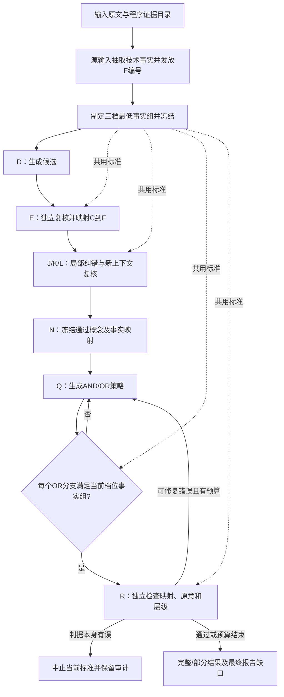

# 自动任务语义判据与报告闭环

日期：2026-11-16。开发分支：`1st-stage`；起点：`9b51170c`。本轮实现自动判据及其消费链路，取消逐篇人工审批要求；工程回归通过，尚未达到整体语义验收标准。

## 已实现哪些功能

| 本轮任务 | 实现内容 | 对应流程环节 |
| --- | --- | --- |
| 固定通用规则 | 记录用户确认的八项规则；人工用于固定基准和异常抽查，正常任务不逐篇签收 | 迭代 0、项目验收 |
| 自动生成任务标准 | 两次独立操作先抽取有证据的主体—动作—对象事实，再生成 strict/medium/broad 最低要求；输入不含待审候选 | C → 新增事实/判据节点 → D |
| 共用并冻结标准 | 判据绑定输入与任务并保存摘要；概念生成、初审、修复与局部复核共用；事实映射随最终 C 编号保存 | D/E/J/K/L/N |
| 策略审核遵循同一标准 | 每个 OR 分支分别满足必需事实组；不能用正确分支掩盖过宽分支。R 审核词项、映射、动作方向和层级，不临时提升可选细节为必需项 | Q/R |
| 缺口进入最终报告 | 完整版及简版展示部分完成、未解决概念编号、失败档位；未产出计划的失败/取消任务也展示。审计与计划不一致时不认证其完整性 | S → 最终报告 |

实现入口包括 `core/task_semantics.py`、`core/planner_report_status.py`、Planner、配置工厂、概念/策略审核、审计、持久化和渲染器，路径均相对于 `backend/src/novelty_agent_framework/`。通用规则见 [semantic-baseline-rules.md](../semantic-baseline-rules.md)，后续验收安排见 [plan-v2.md](../plan-v2.md)。

新增模式需显式开启：

```yaml
concept_review: true
concept_review_protocol: v2
semantic_contract: true
strategy_review: true
```

`semantic_contract` 默认关闭以兼容既有配置；实验驱动可用 `--semantic-contract` 启用。开启该项要求概念审核使用 V2，策略逐档审核还须开启 `strategy_review`。

## 标准怎样自动形成



事实组之间为 AND，组内备选事实为 OR。strict 必须覆盖定义性技术机制；medium/broad 可以省略支持细节，但至少保留一组辨识机制。程序验证来源编号、绑定、覆盖与判据完整性；模型仍承担事实的重要性、等义关系和原意判断。

概念主词采用一个标准词项，等义变体进入单独审核的别名，不同机制拆为不同概念。模型名称或背景概念允许没有事实映射，避免把某模型的全部属性错误附着到名称上。R 发现事实映射或冻结判据本身有误时，可以指出具体错误，不能因程序覆盖检查通过就强制放行。

## 测试与真实模型结果

最终全仓非 live 回归共 **2,098 项：2,095 通过、3 跳过、0 失败、0 错误**，用时 59.668 秒。覆盖源输入先于候选、证据绑定与摘要、非法事实编号、可选细节、每条 OR 分支、概念主词约束、两种配置工厂、审核判据一致性、错误标准中止，以及完整/简版报告的部分、失败、取消、篡改和计划不匹配路径。最终汇总见 [results.json](results.json)。离线测试证明工程行为，不代替独立语义评测。

本轮按发现的问题逐次修复后做必要的小样本测试。下表是**不同实现版本的调试记录，不合并计算通过率**；调用数包括事实/判据、概念、策略请求记录。

| 顺序 | 样例 | 事实/判据 + 概念 + 策略调用 | 结果 | 定位及处理 |
| --- | --- | --- | --- | --- |
| 1 | LightGCN、Fake News，各一次 | 各 1 + 0 + 0 | 均失败 | 事实阶段服务返回 HTTP 502，没有进入概念阶段 |
| 2 | LightGCN | 5 + 0 + 0 | 失败 | 判据输出混入 schema 元数据；后续检查还发现事实组不合要求 |
| 3 | LightGCN | 2 + 2 + 10 | strict、medium 通过 | R 仍将可选加权求和提升为 broad 必需项 |
| 4 | LightGCN | 2 + 2 + 6 | 三档通过 | 加入冻结判据一致性检查后完成；单样例，不证明总体准确率 |
| 5 | Fake News | 4 + 0 + 0 | 失败 | 把目录摘要当成来源 ID；后续从模型可见目录移除摘要/偏移元数据 |
| 6 | Fake News | 3 + 3 + 10 | strict、medium 通过 | broad 复核仍要求可选事实，触发矛盾输出契约修复 |
| 7 | Fake News，最终审核 schema | 3 + 4 + 10 | 仅 strict 通过 | Q 在 medium/broad 共 8 次生成与已通过策略相同的展开式，被拒绝并保留部分结果 |

最终 Fake News 结果比中间版本少通过一档，必须保留这个事实；本轮不能宣称修复已普遍改善模型表现。LightGCN 的三档通过发生在本轮中间版本，最终审核 schema 后未再复跑，不能将两者描述为同一固定版本的对照实验。

真实失败推动的针对性修复：只移除输出顶层多余的 `$defs`/`$schema`，保留业务字段校验；只给模型提供来源编号和文本等必要字段；自动判据模式使用独立 R 输出 schema，覆盖结果由程序计算，模型通过映射/判据错误字段提出异议。没有通过无限重试或放宽状态规则把失败改记成功。

## 仍未解决的缺口

| 缺口 | 环节 | 当前后果与下一步 |
| --- | --- | --- |
| 模型不能稳定产生真正放宽的表达式 | Q | Fake News 中/宽层重复严格层；下一轮应针对实际失败表达式构建回放，明确允许移除/替换的约束并验证展开差异 |
| 自动事实抽取、重要性与 C→F 映射可能误判 | 新增事实/判据、E/K/R | 来源 ID 合法只证明可定位。名称承载全部机制、否定方向、组合与同义仍需固定正反例测量，当前无可靠语义准确率 |
| 冻结标准本身不正确时只会中止 | 判据节点、R | 已实现具体错误反馈与停止；未实现依据异议自动重建标准并开启新一轮任务，不能把停止视为恢复成功 |
| 定义性事实、最低要求也由模型生成 | 判据节点 | 仍存在生成和审核一致误判；不能用同一自动标准的自评替代独立基准 |
| 整体验收样本与注入未补齐 | 迭代 6/8 | 本轮小样本不抵扣 30 个自然 task 和 6 次有效注入，也未测得整体错误放行率、正确修复率 |
| 与论文全文的忠实性未在本层解决 | 上游输入 → C | 当前标准对齐输入查新点与技术特征；上游遗漏或误抽取仍需单独评测 |

下一步优先修 Q 的重复表达式，使用固定输入、固定判据和固定概念目录做离线回放，再做必要的 Qwen 定点复验；之后固定版本开展语义基准和受控注入。无需逐篇人工审批，但项目语义验收仍要独立证据。

本轮没有暂存、提交或推送。公开汇总只保存必要指标与问题分类；原始调试产物不纳入版本控制。
