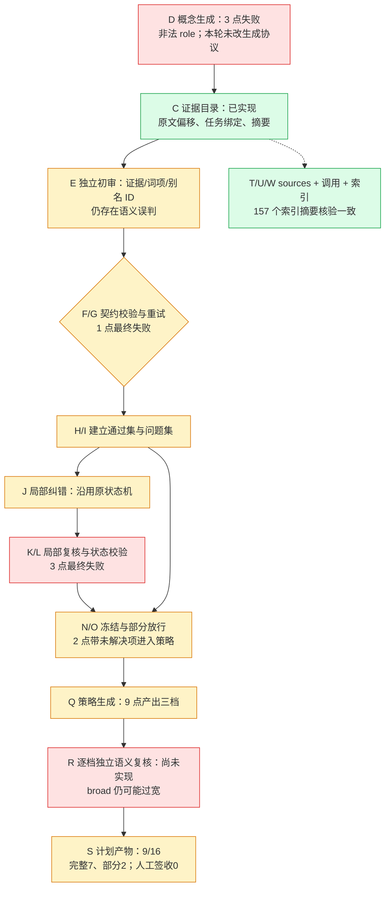

# V2 首轮迭代：按流程图定位结果

## 先看结论

同一批 14 篇、16 点中文 A 场景，旧版产出计划 5/16，V2 产出 9/16（31.25% → 56.25%，+25 个百分点）。V2 中 7 点无遗留问题、2 点部分放行、7 点失败。调用从 77 次增至 96 次（+24.7%）。**工程可完成性有改善迹象，语义纠错尚未证明有效，也未达到 plan-v2 整体验收。**

输入、模型配置、任务语言、每点 24 次调用上限保持一致；模型是 qwen2.5-7b-instruct，temperature=0.2、max_tokens=2048。每点只运行一次，未固定服务端随机种子；16 点中仅 5 点第一次生成的草稿与旧版完全相同，其余候选有变化。因此不能把全部增益归因于证据 ID，不能解释为统计稳定提升。

本轮基于 `1st-stage` / `52ebd3b6` 的未提交工作区运行，新增/修改代码见 [code-snapshot](code-snapshot)，固定批次期间未修改 Planner、Prompt 或配置。未修改旧实验原始产物。


## 流程图：问题现在在哪里

节点字母与 [plan-v2](../plan-v2.md) 对齐。这里展示本轮实际路径：C 目录在 D 结构合法后按需建立，不改变生成 Prompt 的输入；这与目标图 C→D 的调度次序不同。



R 是目标方案节点，不是已执行操作；Q 当前仍使用旧策略编译路径。

| 定位 | 本轮改动/发现 | 前后数据 | 下一步 |
| --- | --- | --- | --- |
| **C（Δ1）** | 新建确定性原文目录；保留 Unicode 偏移、字段边界、语言、摘要；来源位置不作为正文 | 通过目录可逆、重复文本、英文缩写、长字段和任务隔离测试 | 保持纯函数；后续统一在生成前保存目录 |
| **E/F（Δ2/Δ3/Δ4 部分）** | 模型返回证据 ID、词项 ID 和别名 ID；程序恢复原文并检查精确覆盖 | 最终停在初审的案例 5→1；83 条通过契约的候选判断解析出 87 个原文片段 | Keyword Spotting NP-1 无 comparison 却返回非 null 翻译判断，重试无效 |
| **G（Δ5 未完成）** | 错误反馈含候选/字段和合法 ID；仍对当前整份审核响应重试 | 引文复制任务已从 V2 模型契约移除；整体输出仍可能反复犯错 | 实现候选/字段级补丁合并；预算目前仍为阶段共享，未改为逐操作预算 |
| **D** | 生成协议保持不变；模型仍输出 operation/participant/application 等非法分类 | 最终停在生成的案例 5→3 | 单独修生成字段契约，不能归功于证据 ID；D 的部分结果变化来自模型采样 |
| **J/K/L** | 沿用三轮纠错、无变化不得 fixed、冻结通过集规则 | 最终停在局部复核的案例 1→3；累计14次完成的纠错复核，模型/程序记 fixed 2、unresolved 12 | 下一轮独立局部复核 Prompt、issue_id 和字段级状态绑定 |
| **H/N/O** | 按现有部分放行规则输出已通过集 | 2 点保留各1个未解决问题，仍产出计划 | 必须在报告暴露 partial，不能只看驱动 completed |
| **Q/R** | 本轮未重构策略阶段 | 9 个计划包含27条策略；broad 仍有“卷积神经网络”“微调模型”“高分六号影像” | 按原方案补独立语义审核；不能将“有三档”作为策略验收 |
| **T/U/W（Δ6 部分）** | 保存 sources.json、模型选择、解析原文和索引摘要 | 16套审计，157个被索引文件摘要一致；96份运行级调用记录归档 | issue 迁移、统一索引/正式报告接线仍待后续迭代 |

## 具体语义问题：修好格式后仍然会错

**E/K：混淆“共同组成”与“可作为 OR 替代”。** Fake News 的原候选“虚假新闻”被误判为缺乏支撑、角色应改为方法；纠错把它改成同组 terms=`新闻摘要、预训练模型、事实核验`，复核判 fixed。三个词实际表示不同组成部分，作为 OR 互换会破坏技术含义。证据 ID 和字段覆盖均合法，错误仍进入冻结通过集。这条 fixed 不能算人工确认的正确修复。

**E/K：把术语的特定性当成不能替代的理由。** N-BEATS 审核以“原文用了全称”为由否定简称 FC块，并将初审问题带入后续纠错。Land Use 也以“特定技术手段不可替换”为理由拒绝词项，容易产生无效纠错。

**K/L：局部协议没有充分隔离。** Land Use 最终漏报 issue_resolution/resolution_reason；N-BEATS 漏掉 `C3.A1` 的判断；Fake News 在局部复核中越界新增 missing。现有共享契约重试预算耗尽后，即使已有通过候选也停止，不自动绕过校验。

**Q/R：策略可能过宽。** Keyword Spotting NP-2 的 broad 仍仅为“微调模型”，Activity Recognition 的 broad 仅为“卷积神经网络”。尚未执行检索，因此没有召回率/精确率数据；这些只是对照输入可见的机制丢失风险。

## 逐点对照

“完整”指工程流程结束且概念无未解决问题；不是人工语义通过。“部分”指仍有开放问题但产出策略。

| 论文/查新点 | V1 | V2 | 调用 V1→V2 | 当前定位 |
| --- | --- | --- | ---: | --- |
| Land Use NP-1 | 失败 | 失败 | 5→15 | K/L：resolution 缺失 |
| Activity Recognition NP-1 | 失败 | 完整 | 4→4 | Q/R：broad 泛化过宽 |
| Intrusion Detection NP-1 | 完整 | 完整 | 3→3 | Q/R：待独立语义签收 |
| LightGCN NP-1 | 完整 | 完整 | 3→3 | Q/R：待独立语义签收 |
| N-BEATS NP-1 | 完整 | 失败 | 3→11 | K/L：漏别名判断 |
| MobileNetV2 NP-1 | 失败 | 完整 | 17→3 | 本轮初审直接通过；未验证纠错能力 |
| Attention UNet NP-1 | 失败 | 失败 | 4→4 | D：非法分类 |
| Fake News NP-1 | 完整 | 失败 | 3→11 | E/K语义误判，K/L越界 missing |
| DDP-GCN NP-1 | 失败 | 完整 | 4→5 | Q/R：待独立语义签收 |
| Keyword Spotting NP-1 | 失败 | 失败 | 5→5 | E/F：多余翻译判断 |
| Keyword Spotting NP-2 | 完整 | 完整 | 3→3 | Q/R：broad 仅“微调模型” |
| TabNet NP-1 | 失败 | 完整 | 5→3 | Q/R：待独立语义签收 |
| TabNet NP-2 | 失败 | 失败 | 4→4 | D：非法分类 |
| Music Transformer NP-1 | 失败 | 失败 | 4→4 | D：非法分类 |
| jsjyyyj NP-1 | 失败 | 部分 | 5→9 | N/O：1个别名问题未解决 |
| 中文耕地遥感 NP-1 | 失败 | 部分 | 5→9 | N/O：1个别名问题未解决 |

9个产出中有6个从旧版失败转为产出；旧版完成中的2个转为失败，3个保持产出。仅 jsjyyyj 在第一次生成草稿完全相同的条件下，从初审字段错误推进到部分放行；其他变化不能视为严格同草稿对照。

## 实现范围与测试证据

本轮实际完成 plan-v2 迭代1的目录纯函数、迭代2的审核 ID 契约和确定性校验，并接入迭代3的审核路径及迭代5所需的基本证据审计。属于一个证据引用闭环的纵向切片，**没有完成迭代3的字段补丁修复、迭代4的问题状态机和迭代5的统一报告闭环**；迭代0的人工核心清单签收、迭代6受控注入与人工门禁也未完成。下一轮应回到缺口逐项推进。

新协议默认 `v1`，构造器及两种配置工厂支持 `concept_review_protocol=v2`；本次驱动通过 `--protocol v2` 显式启用。V1 保留既有校验。V2 模型不返回 source_quote，程序将证据目录的原文恢复为内部兼容字段，继续复用现有三轮纠错和策略路径。

新专项12项通过，覆盖可逆切分、跨任务/伪造/重复ID、篡改目录、字段错配、uncertain不放行、局部范围、同步/异步完整恢复和证据审计。全仓非 live：**2049项，2046通过、3跳过、0失败，58.236秒**，见 [regression.xml](regression.xml)。脚本替身只验证控制流程，不证明模型语义能力。

证据目录绑定 point/task，验证时重新构造目录核对当前字段和原始偏移。长句采用完整字段回退；暂未生成可选父子片段。候选 ID 仍按本次目录序号发放，issue_id 尚未实现，不能宣称 Δ4 已全部完成。

## 重放与交付

```bash
PYTHONPATH=.:backend/src python scripts/run_planner_corpus.py \
  --output outputs/planner-corpus14-v2-20261116-rerun --workers 4 --protocol v2
```

汇总数据见 [comparison.json](comparison.json)；每点原始请求、响应、sources、解析事件、终态及计划见 [live](live)。以代码快照、输入摘要和批次清单识别版本。

本轮未创建提交、未推送，既有未提交的输入语料和报告均保留。
