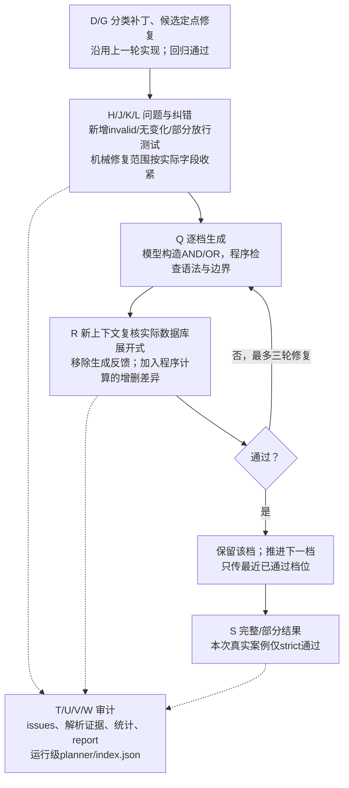

# plan-v2：状态、审计与独立策略复核迭代

日期为2026-11-16。分支为 `1st-stage`，HEAD为 `52ebd3b6`。

## 当前结论

工程实现继续推进到迭代4/5，并实现了可单独验证、可配置接入的迭代7 Q/R策略链路。迭代6真实语义门禁尚未通过，不能描述为按序完成了迭代7验收。

本轮没有重跑14篇全批。工程行为以离线测试验证；仅对新R Prompt使用同一个LightGCN固定概念目录进行3次真实定点测试，每次最多24次调用，实际分别14、17、15次，总计46次。三次均只通过strict，medium和broad失败，输出明确为partial。未获得语义效果提升证据。

## 对照流程图定位



| 节点 | 本轮新增能力 | 仍存在的缺口 |
| --- | --- | --- |
| **H/J/K/L** | 补测撤销原判invalid、无变化fixed被拒、三轮未解决后的部分放行；机械问题只允许修改实际报错字段 | 词项语义身份及翻译修正仍依赖模型判断；issue状态不是人工语义签收 |
| **Q** | strict→medium→broad逐档生成受限AND/OR/括号表达式；最多2000字符、128 token、12层括号；只引用冻结概念 | 新链路默认关闭；尚未做14篇全链路语义验收 |
| **R** | 每次复核为新上下文，看到实际数据库展开式及最近通过策略；逐维判断概念使用、机制保留、档位与调整；uncertain不放行 | 小模型对“哪些机制必须保留”仍不稳定；未有人工判据证明各次接受/拒绝正确 |
| **Q/R 预算** | 每个操作最多3次契约修复；每档首次尝试+最多3轮语义修复；运行级预算先耗尽就停止 | 原有运行级预算不自动提高，复杂概念+策略任务仍可能只保留中间成果后失败 |
| **S** | 只输出已复核档位；缺档标记partial；没有通过档位时失败；预算或取消时审计保留已通过策略 | 部分结果仍需下游和用户按审计状态解释，不能只看是否返回SearchPlan |
| **T/U/V/W** | 独立issues.json、resolved-evidence.json、策略调用、指标和report.md；协议版本及实现摘要；发布到运行级planner/index.json；可按run/point/task读取并核验 | 最终查新报告的Renderer尚未接入这些状态，不能把“有读取接口”说成最终报告已接线 |

## 离线验证

全仓非live回归为 **2073项：2070通过、3跳过、0失败，57.858秒**，见 [regression.xml](regression.xml)。随后补充了数据库配置继承测试并调整工厂接线，最终受影响专项 **45/45通过**，见 [focused.xml](focused.xml)。这45项包含已有测试，不与全仓数字相加。

验证重点：

- 同步、异步完整Planner路径均能启用Q/R，非法概念引用在当前生成操作定点修复。
- 不同策略档位不共享语义纠错计数；失败strict不会被当作下一档的通过参考。
- 相同实际展开式不能冒充新档位；模型写pass但某个维度false或有缺失机制时不放行。
- 预算耗尽、取消立即停止后续档位调用，已有通过档位留在审计中。
- 不向独立复核传递生成器feedback或previous_candidate；传入程序确定的实际增删概念及逐字相同与否。
- 并发任务发布运行级索引不覆盖彼此；绑定检查和篡改检测有效。
- 回放生成记录与真实请求记录分别计数；预算拒绝不计为已派发请求。
- role/source纠错不能偷换terms；不合格别名隔离；无变化不记fixed；invalid不记真实内容修复。

## 仅在必要时做的Qwen定点测试

冻结输入为 [LightGCN概念计划](../corpus14-live-20261116/04-LightGCN/NP-1/plan.json)，查新点为corpus-14的LightGCN NP-1。每次都不调用概念生成，不执行数据库检索，真实调用只用于Q/R。目录来自旧实验，未表示用户已经语义签收。

| 尝试 | 改动 | 真实调用 | 结果 |
| --- | --- | ---: | --- |
| [trial-1](trial-1) | 首次接入Q/R | 14 | strict通过；medium/broad被要求补全所有机制，加回后与strict重复 |
| [trial-2](trial-2) | 澄清medium/broad不必保留strict全部细节 | 17 | 仍仅strict通过；复核还将实际不同的表达式说成完全相同 |
| [trial-3](trial-3) | 移除复核输入中的生成反馈，加入确定性表达式差异 | 15 | 不再依赖生成反馈，仍仅strict通过；放宽判据未稳定 |

三次是三个不同实现/Prompt状态的探索，不能合并为固定版本成功率。原始messages、响应、案例输入摘要、协议与实现指纹均保留；共73个被索引文件摘要核对一致。

### R当前具体问题

1. **把不同档位的目标混同。** 有些复核要求medium/broad也保留LightGCN所有机制，与放宽目标发生冲突。也可能某些省略确实不合适，当前没有人工冻结的最低机制判据，不能把每次拒绝都认作错误。
2. **对相同表达式给出不一致的解释。** 最后一次medium的同一表达式先被认为缺少“非线性激活去除”，后又承认省略不影响核心识别性，却仍建议保留所有机制并拒绝。
3. **反馈循环无法推进。** 生成器补回所有条件后形成与strict相同的查询，程序拒绝；再次减少条件又被复核拒绝。有限轮次和partial保留保证了不会无限运行，但没有产生有效medium/broad。
4. **独立消息不等于独立判断。** 前两次代码显式把生成feedback带入复核，可能诱导复述前判，已经删除。最后一次仍有语义不稳定，说明不能只靠切断对话历史解决。

三次已足以说明当前判据缺口，本轮停止继续提示词试探。下一步应以固定策略正反例明确：strict必须覆盖的组合、medium/broad允许放宽的条件、不能丢失的辨识机制，再比较审核模型是否正确区分，而不是继续提高调用上限。

## 使用方式

默认策略路径保持兼容。通过SearchPlanner配置启用：

```json
{
  "concept_review": true,
  "concept_review_protocol": "v2",
  "strategy_review": true
}
```

strategy_database未指定时，两种工厂均继承当前检索源，确保R看到的查询由对应数据库Adapter展开；也可显式配置。使用已有概念目录独立验证Q/R：

```bash
PYTHONPATH=.:backend/src python scripts/run_planner_strategy_case.py \
  docs/experiments/planner-concept-stage/corpus-14/04-LightGCN/novelty-points.json \
  --frozen-plan docs/experiments/planner-concept-stage/corpus14-live-20261116/04-LightGCN/NP-1/plan.json \
  --output outputs/planner-strategy-new-attempt
```

全链路批量驱动新增 `--strategy-review`，但本轮未执行全批。`scripts/run_planner_corpus.py`现在明确输出partial状态，汇总脚本分别统计计划产出、完整结果和部分结果。

运行级正式审计入口是本次runtime目录的 `planner/index.json`，各attempt有摘要校验和独立report.md，供后续报告接线使用。代码快照见 [code-snapshot](code-snapshot)。

## plan-v2进度

- 迭代0：失败记录和固定草稿可用，人工核心清单签收仍未完成。
- 迭代1/2：基础证据目录与ID协议已实现、离线验证。
- 迭代3/4：定点恢复、问题绑定、独立局部复核及边界主体已实现；真实概念纠错效果尚未通过门禁。
- 迭代5：运行级索引、问题/证据/统计和独立报告已实现；最终查新报告接线未完成。
- 迭代6：未通过，受控注入及人工验收仍缺。
- 迭代7：Q/R可独立运行并可选接入完整Planner；仅单案例探索，语义验收未完成。
- 迭代8：未开始。
